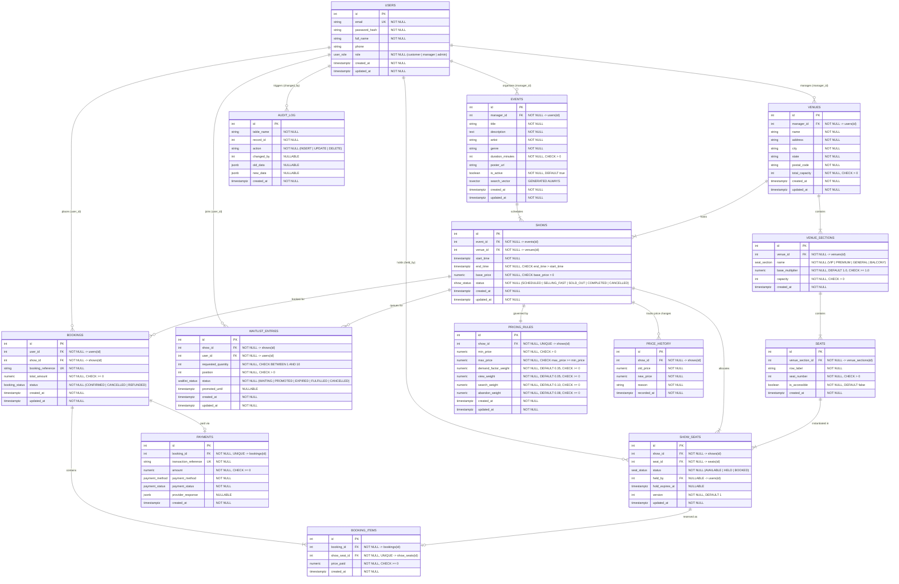

# VenueFlow — Entity Relationship (ER) Diagram & Specification

> **Course Requirement:** Complete Entity-Relationship modeling showing all entities, attributes, primary keys, foreign keys, relationships, cardinalities, and constraints for the VenueFlow platform.

---

## 1. Mermaid ER Diagram

---

## 2. Cardinalities & Relationship Rationale

1. **USERS to VENUES (`1 : N`)**:
   - A manager manages zero, one, or multiple venues.
   - Each venue has exactly one designated manager (`manager_id`).
2. **VENUES to VENUE_SECTIONS (`1 : N`)**:
   - A venue is partitioned into multiple seating sections (`VIP`, `PREMIUM`, `GENERAL`, `BALCONY`).
   - A section belongs to exactly one venue.
3. **VENUE_SECTIONS to SEATS (`1 : N`)**:
   - A section comprises multiple individual seats identified by `(row_label, seat_number)`.
   - `UNIQUE(venue_section_id, row_label, seat_number)` guarantees no duplicate physical seat labels.
4. **EVENTS to SHOWS (`1 : N`) & VENUES to SHOWS (`1 : N`)**:
   - An event can be scheduled across multiple show times and venues.
   - Each show is a specific event at a specific venue at a designated start and end time.
5. **SHOWS to SHOW_SEATS (`1 : N`) & SEATS to SHOW_SEATS (`1 : N`)**:
   - For every show, each physical seat in the hosting venue is instantiated into `SHOW_SEATS`.
   - `UNIQUE(show_id, seat_id)` prevents assigning the same seat to the same show more than once.
   - Contains hold state (`held_by`, `hold_expires_at`) and optimistic locking `version`.
6. **SHOWS to PRICING_RULES (`1 : 1`)**:
   - Every show has exactly one active dynamic pricing policy specifying bounds (`min_price`, `max_price`) and demand coefficients.
7. **BOOKINGS to BOOKING_ITEMS (`1 : N`) & SHOW_SEATS to BOOKING_ITEMS (`1 : 1`)**:
   - A booking can encompass multiple seats (items).
   - Each `show_seat_id` can be referenced by at most one confirmed `booking_items` record (`UNIQUE`).
8. **BOOKINGS to PAYMENTS (`1 : 1`)**:
   - Every booking has a simulated payment ledger record capturing transaction reference, method, and status.
9. **SHOWS to WAITLIST_ENTRIES (`1 : N`) & USERS to WAITLIST_ENTRIES (`1 : N`)**:
   - When a show is sold out, users queue in FIFO order with an explicit integer `position`.
10. **SHOWS to PRICE_HISTORY (`1 : N`)**:
    - Audit log for each dynamic pricing recalculation, capturing price changes and trigger reasons.
